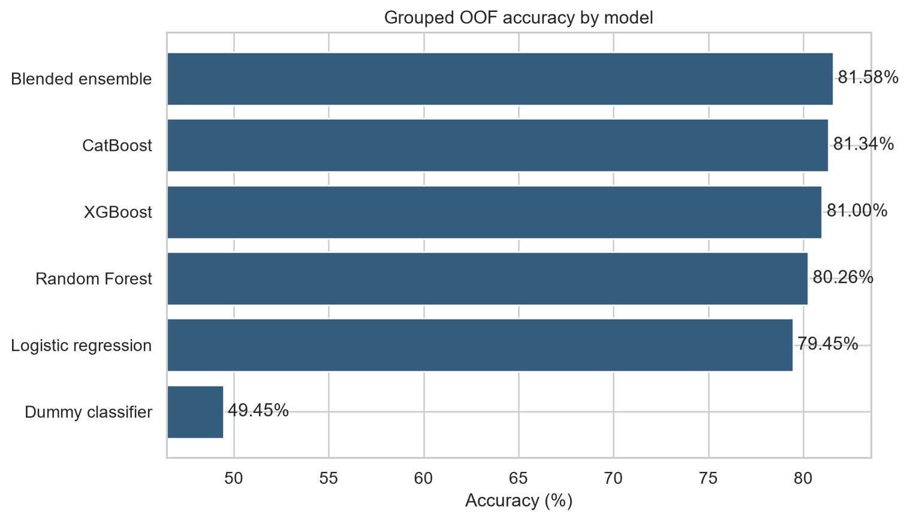
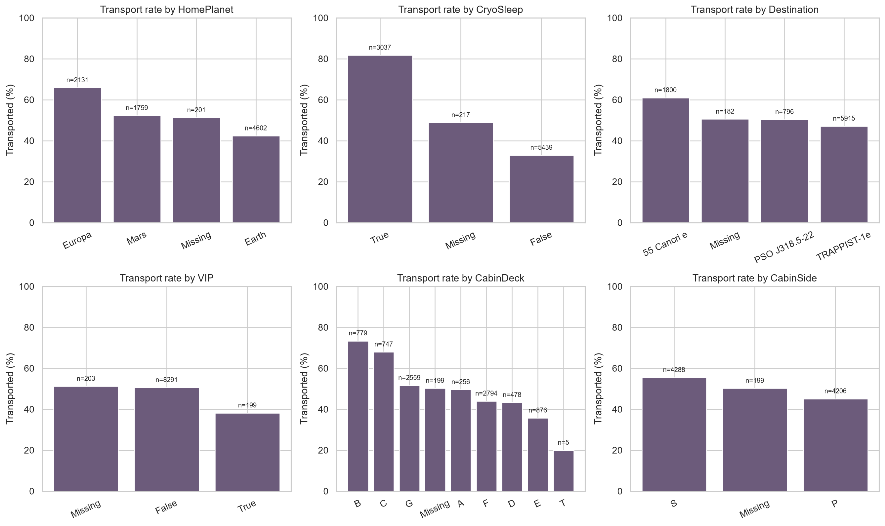
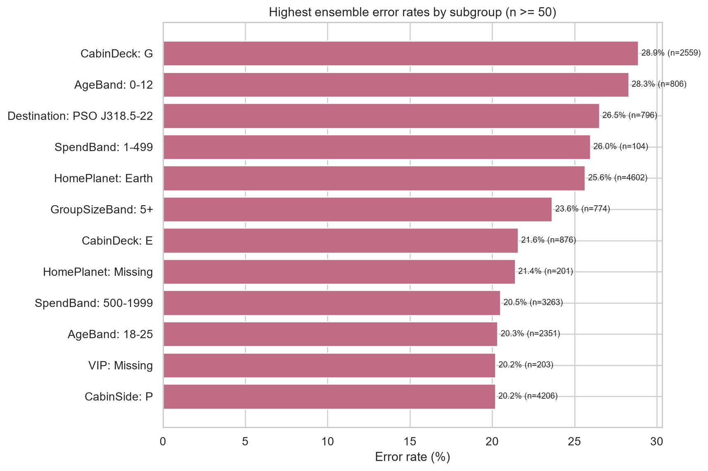

# Spaceship Titanic: Reproducible Classification Project

[](https://www.python.org/)
[](https://www.kaggle.com/competitions/spaceship-titanic)
[](#results)

This repository contains an end-to-end, reproducible solution for Kaggle's
[Spaceship Titanic competition](https://www.kaggle.com/competitions/spaceship-titanic).
The goal is to predict whether each passenger was transported to another dimension after the ship collided with a spacetime anomaly.

The project covers data auditing, exploratory data analysis (EDA), leakage-aware preprocessing, shared feature engineering, model tuning, grouped cross-validation, four required classifiers, model interpretation, subgroup error analysis, and Kaggle submission generation. The current best local result is **0.8158 grouped out-of-fold accuracy** from an XGBoost/CatBoost probability blend.

For a standalone course-project narrative, see [`PROJECT_DESCRIPTION.md`](PROJECT_DESCRIPTION.md).

> The values reported here are local cross-validation results. A Kaggle leaderboard score is only available after `outputs/submission.csv` is uploaded to Kaggle.

## Table of contents

1. [Problem and data](#problem-and-data)
2. [Repository structure](#repository-structure)
3. [Team deliverables](#team-deliverables)
4. [Methodology](#methodology)
5. [Results](#results)
6. [Exploratory findings](#exploratory-findings)
7. [Model interpretation and errors](#model-interpretation-and-errors)
8. [Reproduction](#reproduction)
9. [Generated artifacts](#generated-artifacts)
10. [Software quality and limitations](#software-quality-and-limitations)

## Problem and data

The task is binary classification. For each passenger in `test.csv`, the model must predict a Boolean value for `Transported`. Kaggle evaluates submissions using classification accuracy.

| Item | Value |
|---|---:|
| Training rows | 8,693 |
| Test rows | 4,277 |
| Raw predictors | 13 |
| Engineered model features | 44 |
| Positive target rate | 50.36% |
| Validation | 5-fold `StratifiedGroupKFold` |
| Group key | `PassengerId` prefix |
| Competition metric | Accuracy |

### Raw feature dictionary

| Feature | Type | Description | Train missing rate |
|---|---|---|---:|
| `PassengerId` | identifier | Unique ID in `gggg_pp` form; `gggg` identifies a travel group | 0.00% |
| `HomePlanet` | categorical | Planet of departure | 2.31% |
| `CryoSleep` | Boolean | Whether the passenger entered suspended animation | 2.50% |
| `Cabin` | structured text | Cabin in `deck/number/side` form | 2.29% |
| `Destination` | categorical | Destination planet | 2.09% |
| `Age` | numeric | Passenger age | 2.06% |
| `VIP` | Boolean | Whether VIP service was purchased | 2.34% |
| `RoomService` | numeric | Room-service spending | 2.08% |
| `FoodCourt` | numeric | Food-court spending | 2.11% |
| `ShoppingMall` | numeric | Shopping-mall spending | 2.39% |
| `Spa` | numeric | Spa spending | 2.11% |
| `VRDeck` | numeric | VR-deck spending | 2.16% |
| `Name` | text | Passenger name | 2.30% |
| `Transported` | target | Whether the passenger was transported | 0.00% |

The audit found no duplicate rows, duplicate IDs, invalid passenger-ID formats, invalid cabin formats, negative ages, ages above 100, negative spending values, or cryosleep passengers with positive spending.

The Kaggle source CSVs are intentionally excluded from Git history. Team members must accept the competition rules, download the data, and place the files in `raw data/`.

## Repository structure

```text
spaceship-titanic-software-project/
|-- raw data/
|   |-- README.md
|   |-- train.csv                  # local only; ignored by Git
|   |-- test.csv                   # local only; ignored by Git
|   `-- sample_submission.csv      # local only; ignored by Git
|-- src/
|   |-- pipeline.py                # shared data, features, folds, preprocessing, models
|   |-- eda.py                     # data dictionary, audit, EDA figures and report
|   |-- tune.py                    # grouped-CV parameter search for four models
|   |-- train.py                   # final 5-fold OOF training, blend and submission
|   |-- analyze.py                 # comparison, importance and subgroup errors
|   `-- run_all.py                 # one-command end-to-end workflow
|-- tests/
|   `-- test_project.py            # data, feature, split, model and output contracts
|-- outputs/
|   |-- best_params.json
|   |-- data_quality.csv
|   |-- anomaly_checks.csv
|   |-- tuning_results.csv
|   |-- model_comparison.csv
|   |-- fold_scores.csv
|   |-- feature_importance.csv
|   |-- error_analysis.csv
|   |-- confusion_matrix.csv
|   |-- metrics.json
|   `-- model_summary.md
|-- reports/
|   |-- EDA_REPORT.md
|   |-- MODEL_ANALYSIS.md
|   `-- figures/                    # ten generated PNG figures
|-- README.md
|-- PROJECT_DESCRIPTION.md          # standalone course-project description
|-- REPORT.md
|-- TEAM_PROJECT_OVERVIEW.md
`-- requirements.txt
```

`outputs/submission.csv`, OOF row-level predictions, fold assignments, and the raw Kaggle files are generated locally and ignored by Git. Aggregate, non-sensitive experiment tables and figures are committed so reviewers can inspect the results without retraining.

## Team deliverables

The implementation matches the requested M1-M6 work allocation. Presentation slides are intentionally out of scope for the current version.

| Member | Responsibility | Completed deliverables |
|---|---|---|
| M1 | Problem understanding, data audit and EDA | Data dictionary, missing-value profile, anomaly checks, ten EDA/analysis figures, `reports/EDA_REPORT.md` |
| M2 | Preprocessing, shared features, fixed splits and baselines | Shared feature pipeline, grouped fold assignments, fitted Dummy classifier and Logistic Regression baselines |
| M3 | Random Forest | Training, compact parameter search, OOF/test prediction, feature importance, metrics |
| M4 | XGBoost | Training, compact parameter search, OOF/test prediction, feature importance, metrics |
| M5 | CatBoost | Native categorical model, compact parameter search, OOF/test prediction, feature importance, metrics |
| M6 | Comparison, interpretation and error analysis | Unified results, confusion matrix, subgroup errors, findings, conclusion, reproducible integration |

All models use the same feature definitions and the same five grouped validation folds for a fair final comparison.

## Methodology

### Data validation

Before modelling, the pipeline checks:

- required columns and official file structure;
- unique, non-null passenger IDs across train and test;
- exact alignment of test IDs with `sample_submission.csv`;
- populated target labels;
- official output column order and Boolean prediction values.

### Feature engineering

The 44 engineered inputs are shared by all models. Major feature families include:

| Family | Examples |
|---|---|
| Passenger group | group-member number, group size, solo flag, group mean age/spend, group cryosleep rate |
| Cabin | deck, number, side, cabin region, cabin occupancy |
| Family context | surname frequency and surname-level mean spending |
| Demographics | age, age band, child flag, young-adult flag |
| Spending | original services, log services, total spend, log total, luxury spend, active-service count, maximum spend |
| Missingness | total missing count, missing service count, original age/cabin missing flags |

Raw passenger IDs, full names, and raw surnames are not supplied directly to the estimators.

### Missing-value handling

Feature construction uses manifest information and domain constraints without target labels:

- Positive onboard spending implies the passenger was awake.
- Known members of a travel group help infer missing planet, destination, cryosleep and cabin values.
- Cabin deck supplies a fallback planet signal where appropriate.
- Missing ages use travel-group and planet medians.
- Missing spending for cryosleep passengers is set to zero; remaining values use planet medians and a zero fallback.
- Residual categorical and numeric gaps are handled inside model pipelines with `SimpleImputer`.

Train and test rows are combined only for unlabelled manifest statistics such as group size and cabin occupancy. No test labels exist, and no target-derived feature is used.

### Leakage-resistant validation

Passengers sharing the same ID prefix are often related or travelling together. They can share cabins, destinations and outcomes. An ordinary random split can therefore place related passengers in both training and validation data and produce an optimistic score.

The project uses five-fold `StratifiedGroupKFold`:

- `Group` keeps every travel group in one fold only.
- `Stratified` keeps target rates reasonably balanced.
- Preprocessing is fitted separately inside each training fold.
- Seed `42` makes the folds and estimators reproducible.
- The committed fold assignment makes the final comparison auditable.

### Model lineup and tuning

| Model | Purpose |
|---|---|
| Dummy Classifier | Most-frequent-class reference used to verify that learned models add value |
| Logistic Regression | Interpretable linear baseline after scaling and one-hot encoding |
| Random Forest | Bagged nonlinear trees and robust interaction learning |
| XGBoost | Regularized gradient-boosted trees for sparse encoded features |
| CatBoost | Gradient boosting with native handling of categorical inputs |

`src/tune.py` performs a compact, deterministic grouped three-fold search for each model. The selected configurations are stored in `outputs/best_params.json`. The final evaluation then uses fresh five-fold OOF predictions so all models are scored on identical folds.

The ensemble search evaluates non-negative weights on a fixed simplex and thresholds from 0.44 to 0.56. The selected blend uses only OOF predictions; test predictions do not influence model selection.

## Results

Final grouped five-fold OOF results with seed `42`:

| Model | Accuracy | ROC-AUC | Precision | Recall | F1 | Fold accuracy SD |
|---|---:|---:|---:|---:|---:|---:|
| **Blended ensemble** | **0.8158** | **0.9054** | 0.7893 | **0.8652** | **0.8255** | 0.0150 |
| CatBoost | 0.8134 | 0.9049 | 0.8072 | 0.8271 | 0.8170 | 0.0185 |
| XGBoost | 0.8100 | 0.9035 | **0.8108** | 0.8122 | 0.8115 | **0.0139** |
| Random Forest | 0.8026 | 0.8948 | 0.7979 | 0.8143 | 0.8060 | 0.0164 |
| Logistic Regression | 0.7945 | 0.8859 | 0.7820 | 0.8209 | 0.8010 | 0.0180 |
| Dummy Classifier | 0.4945 | 0.5000 | 0.4988 | 0.7910 | 0.6118 | 0.0115 |

Selected ensemble:

| Setting | Value |
|---|---:|
| Logistic Regression weight | 0.0 |
| Random Forest weight | 0.0 |
| XGBoost weight | 0.4 |
| CatBoost weight | 0.6 |
| Classification threshold | 0.448 |

The boosted models outperform the linear and bagged-tree baselines. The blend adds 0.24 percentage points over CatBoost and 0.59 points over XGBoost. Its confusion matrix contains 3,304 true negatives, 3,788 true positives, 1,011 false positives and 590 false negatives.



## Exploratory findings

The complete EDA is in [`reports/EDA_REPORT.md`](reports/EDA_REPORT.md). Main findings include:

1. Cryosleep has the largest raw separation: 81.8% transported for sleeping passengers versus 32.9% for awake passengers.
2. Zero-spend passengers have a 78.6% transport rate, compared with 29.9% among passengers with positive recorded spending.
3. Children aged 12 or below have a 70.0% transport rate, compared with 48.3% among older passengers.
4. Cabin side S has a 55.5% rate versus 45.1% for side P.
5. Multi-person groups have a 56.7% rate versus 45.2% for solo passengers.
6. Deck-level transport rates vary substantially, especially decks B/C versus E/T.



## Model interpretation and errors

The complete analysis is in [`reports/MODEL_ANALYSIS.md`](reports/MODEL_ANALYSIS.md).

Top-ranked features differ by algorithm:

| Model | Leading signals |
|---|---|
| Logistic Regression | cabin deck C, luxury spending, Europa origin, Spa, VRDeck |
| Random Forest | luxury spending, food/shopping spending, total and log total spend |
| XGBoost | no-spend flag, Earth origin, luxury spending, active-service count |
| CatBoost | luxury spending, home planet, cabin deck/side/number |

Feature importance confirms the EDA themes but does not imply causality. The highest-error groups with at least 50 rows include deck G (28.9%), ages 0-12 (28.3%), destination PSO J318.5-22 (26.5%), low positive spending (26.0%), and Earth passengers (25.6%). These groups are useful targets for further feature development and calibration checks.



## Reproduction

### 1. Clone the repository

```bash
git clone https://github.com/temper-zhong/spaceship-titanic-software-project.git
cd spaceship-titanic-software-project
```

The repository may be private. Ask the owner to add your GitHub account as a collaborator before cloning.

### 2. Create an isolated environment

Windows PowerShell:

```powershell
python -m venv .venv
.\.venv\Scripts\Activate.ps1
python -m pip install --upgrade pip
python -m pip install -r requirements.txt
```

macOS or Linux:

```bash
python3 -m venv .venv
source .venv/bin/activate
python -m pip install --upgrade pip
python -m pip install -r requirements.txt
```

### 3. Download the Kaggle data

Download `train.csv`, `test.csv`, and `sample_submission.csv` from the
[competition data page](https://www.kaggle.com/competitions/spaceship-titanic/data) and place them in `raw data/` with exactly those names.

### 4. Run the tests

```bash
python -m unittest discover -s tests -v
```

### 5. Run a fast smoke test

```bash
python -m src.run_all --quick --output-dir outputs-quick --report-dir reports-quick
```

Quick mode uses reduced model sizes, smaller tuning grids and three final folds. It verifies installation and data placement but does not reproduce the committed scores.

### 6. Reproduce the complete project

```bash
python -m src.run_all
```

The command runs EDA, tuning, five-fold training, blending, interpretation, error analysis and submission generation in the correct order. A typical full run takes several minutes on a laptop; CatBoost is the slowest stage.

Individual stages can also be executed separately:

```bash
python -m src.eda
python -m src.tune
python -m src.train --params-file outputs/best_params.json
python -m src.analyze
```

### 7. Submit to Kaggle

Upload `outputs/submission.csv` on the competition submission page. The file contains exactly 4,277 rows and the required columns:

```text
PassengerId,Transported
0013_01,False
0018_01,False
...
```

## Generated artifacts

| Artifact | Purpose |
|---|---|
| `outputs/data_quality.csv` | Field types, cardinality, missingness and numeric outlier counts |
| `outputs/anomaly_checks.csv` | Explicit integrity and domain-rule checks |
| `outputs/tuning_results.csv` | Fold-level scores for every tuning candidate |
| `outputs/best_params.json` | Selected parameter set for each model |
| `outputs/model_comparison.csv` | Unified accuracy, AUC, precision, recall, F1 and calibration metrics |
| `outputs/fold_scores.csv` | Fold-by-fold model scores and timings |
| `outputs/feature_importance.csv` | Per-fold model-specific importance values |
| `outputs/error_analysis.csv` | Segment-level accuracy, FP/FN counts and probability summaries |
| `outputs/confusion_matrix.csv` | Ensemble OOF confusion-matrix cells |
| `outputs/metrics.json` | Environment, data, validation, model, ensemble and submission metadata |
| `outputs/submission.csv` | Kaggle-ready test predictions, generated locally |
| `reports/EDA_REPORT.md` | Reproducible EDA narrative and findings |
| `reports/MODEL_ANALYSIS.md` | Comparison, interpretation, errors and conclusions |

## Software quality and limitations

Quality controls include fixed random seeds, strict input/output validation, grouped split assertions, preprocessing inside folds, generated fold assignments, recorded package versions, unit tests, and a single orchestration command.

Known limitations:

- Ensemble weights and threshold are selected on one set of OOF predictions and may be mildly optimistic.
- Grouped CV is deliberately strict but may not perfectly match the hidden Kaggle distribution.
- Manifest-level unsupervised aggregates use both supplied passenger lists. No target values are used, but a production deployment with one passenger at a time would need a different design.
- Feature importance is algorithm-specific and descriptive, not causal.
- The final Kaggle public/private score is not known until the submission is uploaded.

Useful next steps include repeated grouped CV across multiple seeds, calibration analysis, ablation studies, group-consistency post-processing, and recording Kaggle scores against an immutable Git commit.

## Acknowledgements

Dataset and competition: Kaggle, Addison Howard, Ashley Chow, and Ryan Holbrook. This repository is an educational software and machine-learning course project.
